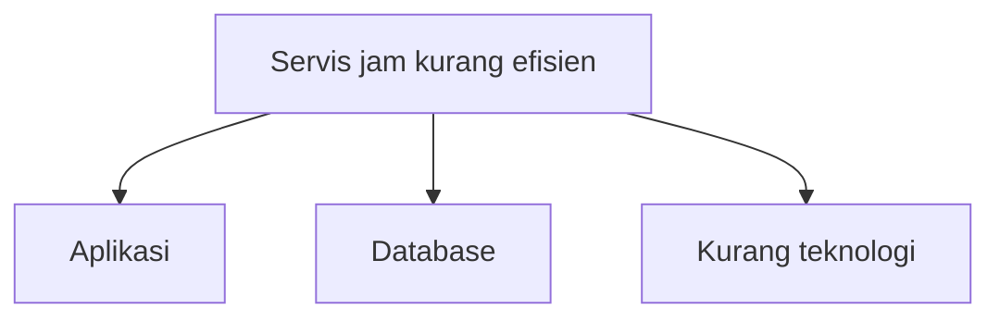
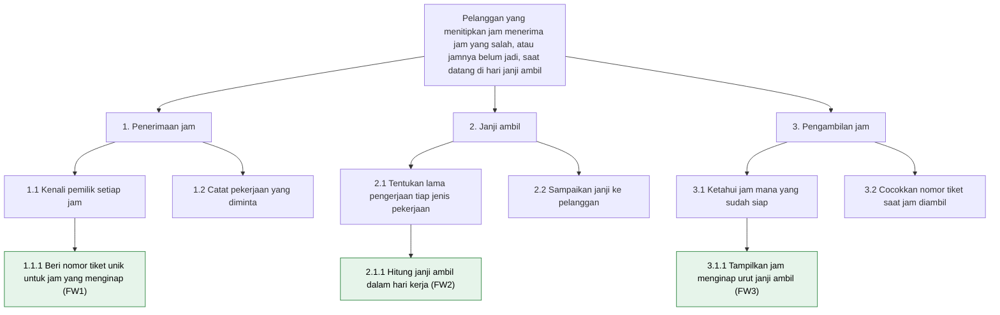
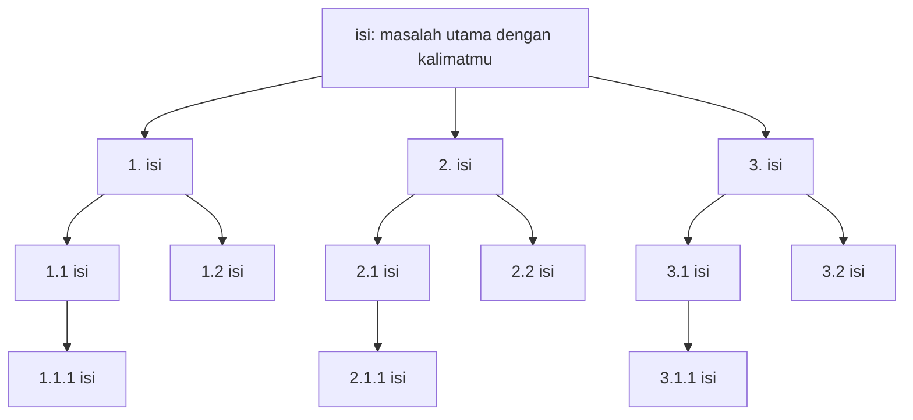

# 02 · Decomposition: Pohon Masalah

**Minggu:** PTS−3 · **Dinilai di:** PTS, kriteria *Decomposition* (15 poin)

> [!TIP]
> **Pilar CT yang dilatih: Decomposition.** Masalah besar ("jam tertukar dan janji meleset") tidak bisa langsung diprogram. Kamu memecahnya sampai setiap bagian cukup kecil untuk dikerjakan dalam satu langkah, lalu menandai bagian mana yang dikerjakan aplikasi.

## 1. Yang harus ada

Satu pohon masalah dalam Mermaid (`flowchart TD`) yang memenuhi semua aturan ini:

- [ ] **Akar (tingkat 0): tepat 1 node**, berisi masalah utama kasusmu dengan kalimatmu sendiri yang **menyebut siapa yang rugi dan kapan** (sama dengan README bagian 2, baris "kalimatku").
- [ ] **Tingkat 1: minimal 3 node.**
- [ ] **Setiap node tingkat 1 punya minimal 2 anak** di tingkat 2.
- [ ] **Setiap cabang tingkat 1 turun sampai tingkat 3** di minimal satu jalurnya.
- [ ] **Setiap Fitur Wajib muncul di minimal 1 node**, ditandai `(FW1)`, `(FW2)`, dan seterusnya.
- [ ] Tabel bukti: **setiap cabang tingkat 1 menyebut minimal 1 kode bukti** dari `01-data-lapangan.md`.
- [ ] Diagram tampil sebagai gambar di github.com (bukan pesan error atau teks mentah).

Anjuran (tidak dinilai sebagai minimum, tetapi memudahkan dibaca): node diberi nomor bertingkat (`1`, `1.1`, `1.1.1`), dan node tingkat 2 dan 3 diawali kata kerja (catat, hitung, tampilkan, cocokkan).

Tidak semua node harus menjadi fitur aplikasi. Sebagian masalah diselesaikan orang, misalnya "sampaikan janji ke pelanggan".

## 2. Cara mengerjakan

1. **Tulis akar.** Satu kalimat masalah yang teramati, bukan solusi, yang menyebut **siapa yang rugi** dan **kapan**. "Pelanggan pulang dengan jam yang salah saat mengambil jam" adalah masalah. "Belum ada aplikasi" bukan masalah, itu solusi yang menyamar.
2. **Pecah akar menjadi 3 sampai 5 bagian.** Cara yang mudah: ikuti urutan kejadian (sebelum, saat, sesudah) atau ikuti siapa yang terlibat.
3. **Turunkan setiap bagian** dengan bertanya "bagian ini terdiri dari langkah apa saja?" Berhenti kalau node sudah bisa dikerjakan dalam satu langkah atau dijawab ya/tidak.
4. **Tandai Fitur Wajib** pada node yang dikerjakan aplikasi.
5. **Cek bukti.** Setiap cabang tingkat 1 harus bisa ditunjukkan di data lapanganmu. Cabang tanpa bukti biasanya karangan.

Menulis Mermaid:

- Selalu beri tanda kutip pada label: `A["1. Penerimaan jam"]`. Titik, titik dua, dan kurung di luar tanda kutip membuat diagram gagal tampil.
- Jangan memakai kata `end` sebagai ID node.
- Lihat hasilnya di [mermaid.live](https://mermaid.live), atau di VS Code dengan ekstensi **Markdown Preview Mermaid Support**, atau langsung di github.com setelah Sync.

## 3. Contoh pengisian

> [!NOTE]
> Kasus netral **Servis Jam Tangan Pak Darto**, tidak ada di bank kasus. **Data fiktif untuk keperluan pembelajaran.** Seandainya kasus ini ada di bank kasus, kolom Fitur Wajib-nya berbunyi "Tiket servis bernomor, janji ambil otomatis, daftar jam menginap". Tiga butir itu menjadi **FW1** tiket servis bernomor, **FW2** janji ambil otomatis, **FW3** daftar jam menginap.

### Contoh buruk

Masalahnya: akar tidak teramati ("kurang efisien" bisa berarti apa saja), node tingkat 1 berisi solusi dan teknologi, bukan masalah, dan pohonnya berhenti di tingkat 1.

### Contoh baik

Cek aturan: 1 akar yang menyebut siapa yang rugi (pelanggan yang menitipkan jam) dan kapan (saat datang di hari janji ambil); 3 node tingkat 1; masing-masing punya 2 anak; ketiga cabang turun sampai tingkat 3; FW1, FW2, dan FW3 masing-masing muncul di satu node.

| Cabang tingkat 1 | Bukti dari `01` |
|---|---|
| 1. Penerimaan jam | T06 tertukar dengan T02; T15 hampir tertukar dengan T16 |
| 2. Janji ambil | 5 janji meleset: T02, T06, T11, T15, T19 |
| 3. Pengambilan jam | T02 (pelanggan datang, belum jadi); T11 (pelanggan tanya lewat WA 2 kali) |

## 4. Cek sebelum commit

- [ ] Akar berisi masalah yang teramati (siapa yang rugi dan kapan), bukan solusi atau nama teknologi.
- [ ] Ada minimal 3 node tingkat 1, masing-masing dengan minimal 2 anak dan satu jalur sampai tingkat 3.
- [ ] Setiap Fitur Wajib muncul di satu node dengan tanda `(FW...)`.
- [ ] Setiap cabang tingkat 1 punya bukti dari `01-data-lapangan.md`.
- [ ] Diagram tampil sebagai gambar di github.com.

## 5. Isianmu

Semua yang ada di bawah judul ini adalah isianmu, dan hanya bagian ini yang diperiksa dosen. Jangan menghapus judul ini dan jangan menambah bagian baru sesudahnya.

### 5.1 Fitur Wajib kasusku

| Kode | Fitur Wajib (sama dengan README bagian 5) |
|---|---|
| FW1 | `<isi>` |
| FW2 | `<isi>` |
| FW3 | `<isi>` |

### 5.2 Pohon masalah

Ganti label di bawah ini. Tambah node sesuai kebutuhan; jumlah di kerangka ini adalah batas minimum.

### 5.3 Bukti setiap cabang tingkat 1

| Cabang tingkat 1 | Bukti dari `01` |
|---|---|
| 1. `<isi>` | `<isi: kode N atau T, dan kejadiannya>` |
| 2. `<isi>` | `<isi>` |
| 3. `<isi>` | `<isi>` |
