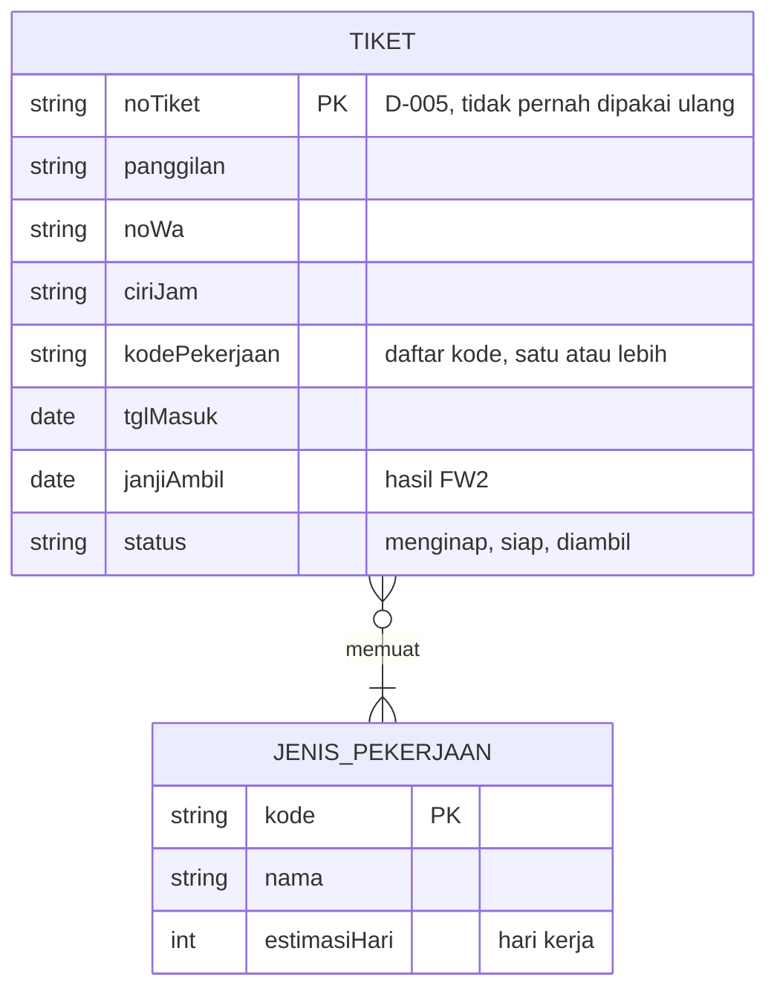
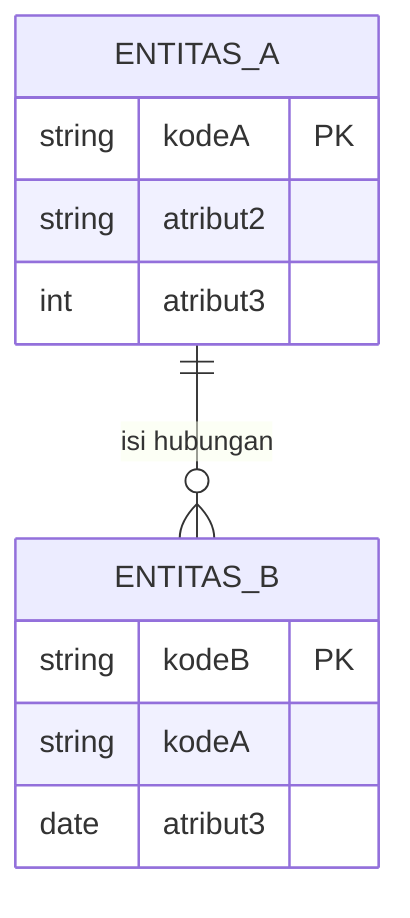

# 03 · Pattern & Abstraction: Pola, Model Data, dan yang Diabaikan

**Minggu:** PTS−2 · **Dinilai di:** PTS, kriteria *Pattern & data lapangan* (bagian 5.1, bersama `01`) dan *Abstraction* (bagian 5.2 dan 5.3), masing-masing 15 poin

> [!TIP]
> **Pilar CT yang dilatih: Pattern Recognition dan Abstraction.** Pattern Recognition: menemukan apa yang berulang di data dan membuktikannya dengan hitungan. Abstraction: memutuskan data apa yang disimpan aplikasi, dan berani membuang sisanya dengan alasan.

## 1. Yang harus ada

**5.1 Pola**

- [ ] **Minimal 3 pola.**
- [ ] Setiap pola punya **hitungan berbentuk "x dari y"** (misalnya "5 dari 20 tiket"), bukan kata "sering" atau "kebanyakan".
- [ ] Setiap pola menyebut **kode bukti** dari `01` (N atau T).
- [ ] Setiap pola punya **akibat untuk desain**: FW, atribut, atau aturan yang lahir dari pola itu.

**5.2 Model data**

- [ ] **Minimal 2 entitas**, masing-masing dengan **minimal 3 atribut**.
- [ ] Setiap atribut punya **tipe** (teks, angka, tanggal, ya/tidak, daftar) dan **contoh nilai**.
- [ ] Setiap entitas punya **1 atribut kunci** (nilai unik, ditandai `PK`).
- [ ] Setiap atribut **dipakai** oleh minimal satu FW, Tantangan Bonus, atau pola. Atribut yang tidak dipakai siapa pun pindahkan ke 5.3.
- [ ] Hubungan antarentitas ditulis, dengan `erDiagram` Mermaid atau satu kalimat.

**5.3 Yang sengaja diabaikan**

- [ ] **Minimal 3 hal**, masing-masing dengan **alasan** yang menunjuk ke data, pola, atau FW.

## 2. Cara mengerjakan

### 2.1 Mencari pola

1. **Hitung per kategori.** Berapa transaksi per jenis barang, per hari, per kanal? Berapa narasumber yang menyebut kejadian yang sama?
2. **Bandingkan kelompok.** Kalau ada baris bermasalah, apa yang sama di antara baris-baris itu dan berbeda dari baris lain?
3. **Cari kata "selalu" dan "tidak pernah"** di datamu, lalu buktikan dengan hitungan.
4. **Tulis penyebutnya.** "5 janji meleset" tidak berarti apa-apa tanpa "dari berapa". Hitung sendiri, misalnya dengan `COUNTIF` di spreadsheet atau mencentang baris satu per satu.

AI sering salah menghitung dari tabel yang ditempel. Kalau kamu memakai AI untuk menghitung, cocokkan hasilnya dengan hitunganmu sendiri, lalu catat di `prompt-journal.md`.

### 2.2 Membuat model data

1. Tulis kata benda yang muncul di Fitur Wajib dan pola. Itu calon **entitas** (tiket, menu, kamar) dan **atribut** (nomor, harga, status).
2. Untuk setiap atribut, tanya: **FW mana yang membaca atau mengubahnya?** Tidak ada jawaban berarti atribut itu dibuang.
3. Pilih satu **kunci** per entitas: nilai yang tidak mungkin sama untuk dua data (nomor tiket, kode menu). Nama orang bukan kunci.
4. Pakai nama atribut yang sama persis di `04-algorithm.md` dan di kode. Format yang dianjurkan: `camelCase`, misalnya `janjiAmbil`.

### 2.3 Memilih yang diabaikan

Abstraksi yang baik terlihat dari apa yang dibuang. Calon yang biasa dibuang: data yang tidak dibaca FW, detail yang tidak mengubah keputusan, dan data pribadi yang tidak perlu.

## 3. Contoh pengisian

> [!NOTE]
> Kasus netral **Servis Jam Tangan Pak Darto**, memakai 20 transaksi contoh di `01-data-lapangan.md`. **Data fiktif untuk keperluan pembelajaran.** Hari ke-7 adalah Minggu, kios tutup; "hari kerja" berarti Senin sampai Sabtu.

### Pola

| Kode | Pola | Hitungan | Bukti | Akibat untuk desain |
|---|---|---|---|---|
| P1 | Ganti baterai dan ganti tali selesai di hari masuk dan tidak pernah tertukar. | 11 dari 20 tiket selesai di hari masuk (8 baterai, 3 tali); 0 dari 11 tertukar | T01, T03, T05, T07, T09, T10, T12, T14, T17, T18, T20 | Tiket bernomor (FW1) hanya untuk 9 jam yang menginap. |
| P2 | Janji ambil selalu "dua hari lagi" (Minggu digeser ke Senin), apa pun pekerjaannya. Pekerjaan mesin selalu meleset, kaca tidak pernah. | Janji "dua hari" pada 9 dari 9 jam menginap. Mesin meleset 5 dari 5, lama nyata 3 sampai 4 hari kerja. Kaca meleset 0 dari 4, lama nyata 1 hari kerja | Mesin: T02, T06, T11, T15, T19. Kaca: T04, T08, T13, T16 | Atribut `estimasiHari` per jenis pekerjaan, diambil dari lama terlama yang teramati: mesin 4, kaca 1. Dipakai FW2. |
| P3 | Semua jam yang tertukar atau hampir tertukar adalah jam menginap berciri analog hitam bertali kulit. | 4 dari 9 jam yang menginap berciri analog hitam bertali kulit, dan keempatnya terlibat dalam 2 kejadian tertukar atau hampir tertukar. 0 dari 11 jam yang selesai di tempat terlibat | Tertukar: T02 dan T06; T15 dan T16. Menginap lain: T04, T08, T11, T13, T19 | Ciri jam tidak bisa menjadi pengenal. Setiap jam menginap diberi `noTiket` unik (FW1). |

### Model data

Satu tiket memuat satu atau lebih jenis pekerjaan; satu jenis pekerjaan bisa muncul di banyak tiket.

| Entitas | Atribut | Tipe | Contoh nilai | Dipakai oleh |
|---|---|---|---|---|
| TIKET | `noTiket` (PK) | teks | `D-005` | FW1, FW3, P3 |
| TIKET | `panggilan` | teks | `Bu Sum` | FW1, FW3 |
| TIKET | `noWa` | teks | `628xxxxxxxxxx` (disamarkan di dokumen ini) | Bonus (pesan wa.me) |
| TIKET | `ciriJam` | teks | `analog perak, rantai` | FW1 (keterangan, bukan pengenal; P3) |
| TIKET | `kodePekerjaan` | daftar teks | `["MSN", "KCA"]` | FW2 |
| TIKET | `tglMasuk` | tanggal | Jumat, hari ke-5 | FW2 |
| TIKET | `janjiAmbil` | tanggal | Rabu, hari ke-10 (hasil FW2) | FW2, FW3 |
| TIKET | `status` | teks | `menginap` (pilihan: `menginap`, `siap`, `diambil`) | FW3 |
| JENIS_PEKERJAAN | `kode` (PK) | teks | `MSN` | FW2 |
| JENIS_PEKERJAAN | `nama` | teks | `Servis mesin` | FW1 |
| JENIS_PEKERJAAN | `estimasiHari` | angka | `4` | FW2, P2 |

Contoh nilai TIKET diambil dari satu tiket, T11 (tiket menginap kelima, jadi `D-005`). Di aplikasi, tanggal disimpan sebagai tanggal kalender; di dokumen ini ditulis sebagai "hari ke-" supaya cocok dengan data `01`.

Isi tabel `JENIS_PEKERJAAN`: `BAT` ganti baterai 0, `TLI` ganti tali 0, `KCA` ganti kaca 1, `MSN` servis mesin 4 (hari kerja). Pekerjaan baterai dan tali tetap ada di tabel karena jam yang menginap bisa juga minta ganti baterai.

### Yang sengaja diabaikan

| Hal | Alasan |
|---|---|
| Jam yang selesai di tempat (baterai, tali) tidak diberi tiket | P1: 11 dari 20 selesai di hari masuk dan 0 tertukar. Tiket untuk mereka hanya menambah antrean ketik. |
| Merek dan model jam | Tidak ada di nota dan tidak dibaca FW1 sampai FW3. `ciriJam` cukup sebagai keterangan. |
| Pelanggan sebagai entitas sendiri (riwayat servis per orang) | Tidak ada FW yang membutuhkan riwayat. `panggilan` dan `noWa` cukup disimpan di tiket. |
| Biaya servis | Tetap ditulis di nota kertas Pak Darto. Tidak dibaca FW1 sampai FW3. |

## 4. Cek sebelum commit

- [ ] Ada 3 pola, masing-masing dengan hitungan "x dari y", kode bukti, dan akibat untuk desain.
- [ ] Hitungan sudah kucocokkan sendiri dengan data di `01`, bukan hanya dari jawaban AI.
- [ ] Ada 2 entitas dengan masing-masing 3 atribut bertipe, contoh nilai, dan 1 kunci.
- [ ] Setiap atribut punya isian "Dipakai oleh".
- [ ] Ada 3 hal yang sengaja diabaikan, masing-masing dengan alasan.

## 5. Isianmu

Semua yang ada di bawah judul ini adalah isianmu, dan hanya bagian ini yang diperiksa dosen. Jangan menghapus judul ini dan jangan menambah bagian baru sesudahnya.

### 5.1 Pola

| Kode | Pola | Hitungan ("x dari y") | Bukti | Akibat untuk desain |
|---|---|---|---|---|
| P1 | `<isi>` | `<isi>` | `<isi: kode N atau T>` | `<isi: FW, atribut, atau aturan>` |
| P2 | `<isi>` | `<isi>` | `<isi>` | `<isi>` |
| P3 | `<isi>` | `<isi>` | `<isi>` | `<isi>` |

### 5.2 Model data

Diagram (dianjurkan). Ganti nama entitas dan atribut:

Hubungan antarentitas (satu kalimat): `<isi>`

| Entitas | Atribut | Tipe | Contoh nilai | Dipakai oleh |
|---|---|---|---|---|
| `<isi>` | `<isi>` (PK) | `<isi>` | `<isi>` | `<isi: FW, Bonus, atau pola>` |
| `<isi>` | `<isi>` | `<isi>` | `<isi>` | `<isi>` |
| `<isi>` | `<isi>` | `<isi>` | `<isi>` | `<isi>` |
| `<isi>` | `<isi>` (PK) | `<isi>` | `<isi>` | `<isi>` |
| `<isi>` | `<isi>` | `<isi>` | `<isi>` | `<isi>` |
| `<isi>` | `<isi>` | `<isi>` | `<isi>` | `<isi>` |

### 5.3 Yang sengaja diabaikan

| Hal | Alasan (tunjuk data, pola, atau FW) |
|---|---|
| `<isi>` | `<isi>` |
| `<isi>` | `<isi>` |
| `<isi>` | `<isi>` |
