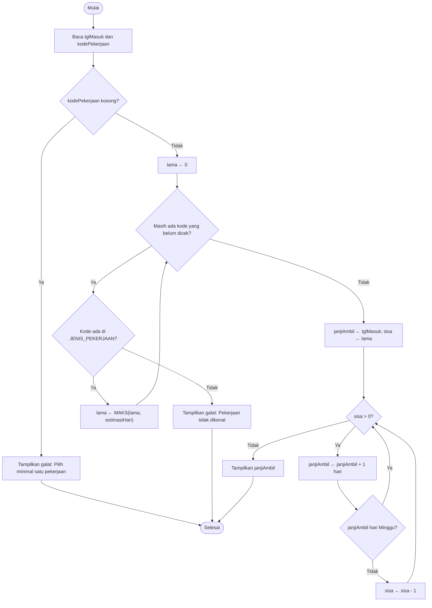
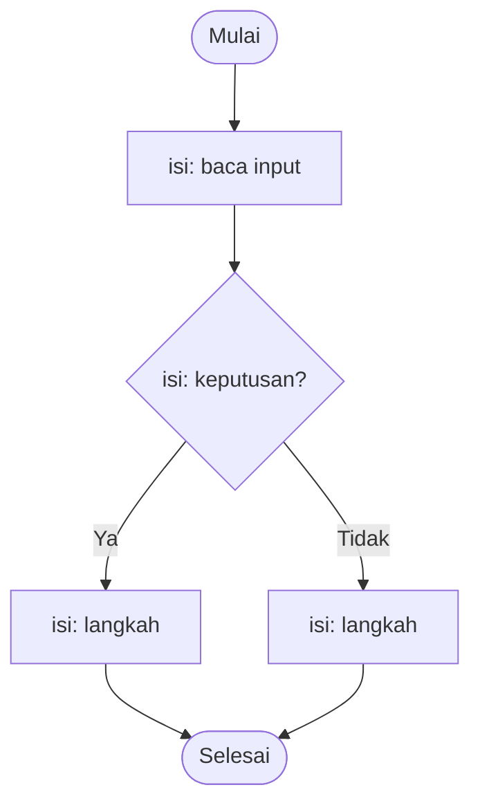

# 04 · Algorithm Design: Flowchart dan Pseudocode per Fitur Wajib

**Minggu:** PTS−1 · **Dinilai di:** PTS, kriteria *Algorithm (flowchart + pseudocode)* (15 poin)

> [!TIP]
> **Pilar CT yang dilatih: Algorithm Design.** Setiap Fitur Wajib ditulis sebagai langkah yang cukup kaku untuk diterjemahkan ke kode, dan cukup jelas untuk dibaca pemilik UMKM. Bagian kasus tepi melatih **Evaluation**: kamu mencari di mana algoritmamu bisa salah sebelum kodenya ada.

## 1. Yang harus ada

Untuk **setiap** Fitur Wajib (FW1, FW2, dan seterusnya, sama dengan README bagian 5), ada empat bagian:

- [ ] **Input dan output**: data apa yang masuk (nama atribut dari `03`) dan apa yang keluar, termasuk pesan galat.
- [ ] **1 flowchart Mermaid** dengan node `Mulai` dan `Selesai`, dan **minimal 1 keputusan** (belah ketupat) yang punya **tepat 2 cabang berlabel** (misalnya `Ya` dan `Tidak`).
- [ ] **Pseudocode** yang memakai **nama atribut yang sama persis** dengan model data di `03`.
- [ ] **Minimal 1 kasus tepi**, dengan hasil yang diharapkan.

Ditambah satu bagian untuk seluruh file:

- [ ] **1 uji tangan** untuk FW yang paling rumit: satu contoh input yang kamu jalankan sendiri baris demi baris sampai keluar output.

## 2. Cara mengerjakan

### 2.1 Aturan pseudocode

- Kata kunci: `JIKA ... MAKA ... SELAIN ITU`, `UNTUK SETIAP ... DALAM ...`, `SELAMA`, `KEMBALIKAN`. Nama proses ditulis `NAMA_PROSES(input)`.
- Satu langkah satu baris. Isi blok ditulis menjorok.
- Tidak ada kata yang tidak bisa diprogram: "secukupnya", "segera", "biasanya", "kalau perlu".
- Angka aturan ditulis jelas, dan asalnya ada di `03` (misalnya `estimasiHari` dari pola P2).

### 2.2 Aturan flowchart

- Oval untuk mulai dan selesai: `S(["Mulai"])`. Kotak untuk langkah: `A["Hitung total"]`. Belah ketupat untuk keputusan: `D{"Stok kurang dari 5?"}`.
- Setiap keputusan punya tepat 2 cabang berlabel: `D -- "Ya" --> ...` dan `D -- "Tidak" --> ...`. Cabang tanpa label adalah tempat bug bersembunyi.
- Perulangan digambar sebagai panah yang kembali ke keputusan sebelumnya.
- Label selalu diberi tanda kutip, dan jangan memakai `end` sebagai ID node.

### 2.3 Mencari kasus tepi

Bug paling sering muncul di batas, bukan di tengah. Tanyakan untuk setiap input:

- Bagaimana kalau kosong, nol, atau negatif?
- Bagaimana kalau tepat di batas aturan, dan satu langkah di luar batas?
- Bagaimana kalau datanya sangat banyak atau sangat besar?
- Bagaimana kalau ada dua pilihan sekaligus, atau data yang sama dimasukkan dua kali?
- Bagaimana kalau hasilnya jatuh di hari libur atau jam tutup?

Kasus tepi di sini menjadi bahan kasus uji di `05-testing.md`.

## 3. Contoh pengisian

> [!NOTE]
> Kasus netral **Servis Jam Tangan Pak Darto**. **Data fiktif untuk keperluan pembelajaran.** Contoh ini hanya menunjukkan **satu** fitur (FW2), dan FW2 juga dipilih untuk uji tangan karena paling rumit. File milikmu memuat empat bagian untuk **setiap** FW, ditambah satu uji tangan.

### FW2 · Janji ambil otomatis

**Input:** `tglMasuk` (tanggal), `kodePekerjaan` (daftar kode), tabel `JENIS_PEKERJAAN` (`kode`, `estimasiHari`).
**Output:** `janjiAmbil` (tanggal), atau pesan galat. Kios tutup hari Minggu, jadi lama pengerjaan dihitung dalam hari kerja.

**Flowchart**



**Pseudocode**

```text
HITUNG_JANJI_AMBIL(tglMasuk, kodePekerjaan, JENIS_PEKERJAAN)
  JIKA kodePekerjaan kosong MAKA
    KEMBALIKAN galat "Pilih minimal satu pekerjaan"
  lama ← 0
  UNTUK SETIAP kode DALAM kodePekerjaan
    JIKA kode tidak ada di JENIS_PEKERJAAN MAKA
      KEMBALIKAN galat "Pekerjaan tidak dikenal: " + kode
    lama ← MAKS(lama, JENIS_PEKERJAAN[kode].estimasiHari)
  janjiAmbil ← tglMasuk
  sisa ← lama
  SELAMA sisa > 0
    janjiAmbil ← janjiAmbil + 1 hari
    JIKA janjiAmbil bukan hari Minggu MAKA
      sisa ← sisa - 1
  KEMBALIKAN janjiAmbil
```

`MAKS`, bukan jumlah: jam T11 (mesin dan kaca) selesai dalam 4 hari kerja, sama dengan lama mesin saja. Cek ke data `01`: dengan aturan ini, 20 dari 20 tiket contoh selesai paling lambat pada janji ambilnya.

**Kasus tepi**

| ID | Kasus | Hasil yang diharapkan | Sumber aturan |
|---|---|---|---|
| K1 | `kodePekerjaan` kosong | Galat "Pilih minimal satu pekerjaan"; tiket tidak disimpan | FW1: setiap tiket memuat pekerjaan |
| K2 | Masuk Sabtu, pekerjaan `KCA` (1 hari) | `janjiAmbil` = Senin, Minggu dilewati | Kios tutup Minggu (`01`) |
| K3 | Pekerjaan `MSN` dan `KCA` sekaligus | `lama` = 4, bukan 5 | Pola P2 dan tiket T11 |

**Uji tangan (FW2, fitur paling rumit):** masuk Rabu, `kodePekerjaan` = `["MSN", "KCA"]`

| Langkah | `lama` | `janjiAmbil` | `sisa` |
|---|---|---|---|
| Kode `MSN`: MAKS(0, 4) | 4 | | |
| Kode `KCA`: MAKS(4, 1) | 4 | | |
| Mulai hitung hari | 4 | Rabu | 4 |
| +1 hari | 4 | Kamis | 3 |
| +1 hari | 4 | Jumat | 2 |
| +1 hari | 4 | Sabtu | 1 |
| +1 hari, Minggu dilewati | 4 | Minggu | 1 |
| +1 hari | 4 | Senin | 0 |

Output: `janjiAmbil` = **Senin**.

## 4. Cek sebelum commit

- [ ] Setiap FW di README punya bagian di file ini.
- [ ] Setiap flowchart punya Mulai, Selesai, dan keputusan dengan dua cabang berlabel, serta tampil sebagai gambar di github.com.
- [ ] Nama atribut di pseudocode sama persis dengan model data di `03`.
- [ ] Setiap FW punya minimal 1 kasus tepi, dan ada 1 uji tangan untuk FW paling rumit yang sudah kujalankan sendiri.
- [ ] Langkah dan keputusan di flowchart sama dengan pseudocode-nya (cek diri, supaya kode nanti tidak bingung mengikuti yang mana).

## 5. Isianmu

Semua yang ada di bawah judul ini adalah isianmu, dan hanya bagian ini yang diperiksa dosen. Jangan menghapus judul ini dan jangan menambah bagian baru sesudahnya.

Salin blok FW di bawah ini sekali untuk setiap FW. Nomori kasus tepi berurutan di seluruh file (K1, K2, dan seterusnya). Uji tangan ditulis sekali saja, di bagian paling bawah.

### FW1 · `<isi: nama fitur>`

**Input:** `<isi: nama atribut dari 03 dan tipenya>`
**Output:** `<isi: hasil dan pesan galat>`

**Flowchart**



**Pseudocode**

```text
NAMA_PROSES(input)
  isi
```

**Kasus tepi**

| ID | Kasus | Hasil yang diharapkan | Sumber aturan |
|---|---|---|---|
| K1 | `<isi>` | `<isi>` | `<isi>` |

### FW2 · `<isi: nama fitur>`

`<isi: salin empat bagian seperti FW1>`

### FW3 · `<isi: nama fitur>`

`<isi: salin empat bagian seperti FW1>`

### Uji tangan: FW `<isi: nomor FW yang paling rumit>`

Input yang dicoba: `<isi>`

| Langkah | `<variabel 1>` | `<variabel 2>` |
|---|---|---|
| `<isi>` | | |

Output: `<isi>`
